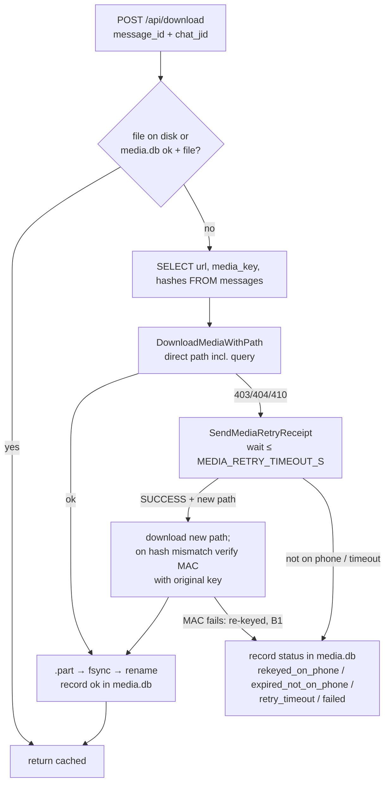

# WhatsApp Voice / Audio Download Plan

Single plan for downloading WhatsApp voice notes and audio: on demand, in bulk from chat history, and automatically for chosen contacts and groups. It replaces the earlier `VOICE_DOWNLOAD_MILESTONE_1.md`, which is now **Milestone 1** below.

**Status as of 2026-09-20:** Milestone 1 and **Phase 0 are complete and deployed.** Milestone 1: full history batch download executed on `972523996302` / `18674685612157@lid` (4,062 items): 106 recoverable voice notes downloaded as `.ogg` (all valid Opus), everything else recorded with an explicit status in `media.db` and `index.json`, 0 writes to `messages.db`; §5.6 is 100% satisfied. Phase 0: Python deps pinned below MCP 2.x, whatsmeow on `20260917111002` and Go 1.26 live since 2026-09-20 20:26 UTC (§2.10). **Phase 1 (schema v1)** deployed 2026-09-21 07:36 UTC (§2.11): new audio messages are tagged with `is_ptt`, `seconds`, `mimetype` and `direct_path`, and B10 is fixed. Next is **Phase 5** (batch by sender) or **Phase 2/3** (MCP tools). One decision still open: re-pairing after S1 (§2.4 step 1) — deferred.

Legend: ✅ done · 🟡 partly done / done with open issues · ❌ not started · 🐞 known bug

---

## 1. Goals

| # | Goal | Delivered by | Status |
|---|---|---|---|
| G1 | Download a single voice message (or any audio) on demand | Milestone 1 (`POST /api/download`) + Phase 3 MCP tool | 🟡 works for media up to ~11–19 days old; older is unrecoverable (B1) |
| G3 | Download past voice messages from one chat or group | Milestone 1 (batch job) → Phase 5 (by sender, history request) | ✅ batch job run over the target contact's full history (4,062 items, §2.9); only the last ~11–19 days are recoverable (B1) |
| G2 | Auto-download voice messages from chosen users / groups, using the webhook trigger rules | Phase 4 | ❌ |

Order: **Milestone 1 ✅ → Phase 0 ✅ → Phase 1 ✅ + Phase 5 ← next → Phases 2/3 → Phase 4 → Phase 6.**

---

## 2. Current state and next steps

### 2.1 Current state (2026-09-20)

| Check | Result |
|---|---|
| Milestone 1 live run (§5.5) | ✅ Executed on full history (4,062 items) of `972523996302` / `18674685612157@lid` |
| Files downloaded | `store/media/972523996302/`: 106 `.ogg` (106/106 valid `OggS` headers, dating back to 2026-09-04) + `index.json` (4,062 entries: 106 `ok`, 339 `rekeyed_on_phone`, 1 `expired_not_on_phone`, 3616 `failed`) |
| `media.db` totals | `ok` 107 (106 contact + 1 group) · `rekeyed_on_phone` 339 · `expired_not_on_phone` 1 · `failed` 3619 · `retry_timeout` 1 |
| Target chat `messages` rows | 20,096 rows; **byte-identical** before/after (`diff /tmp/m1_before.txt /tmp/m1_after.txt` completely empty) |
| DB Integrity | `PRAGMA integrity_check` on backups: `ok`; `PRAGMA quick_check` on live `messages.db`: `ok`; table list unchanged |
| Idempotency | Re-running the batch job on 4,062 items: **`skipped: 4062`, `done: 0`, `failed: 0`** in 15 s |
| Backups taken | `store/backups/messages_20260919_174021.db`, `whatsapp_20260919_174021.db`, `media_20260919_174021.db` (all integrity `ok`) |
| Image tag | `whatsapp-bridge:pre-m1` |

**Morning snapshot (before fixes S1/S2, kept for history):**

| Check | Result |
|---|---|
| `go vet ./...`, `go test ./...` | clean / pass |
| `GET /api/media/whatsapp.db`, `messages.db`, `media.db`, `../whatsapp.db`, `%2e%2e/whatsapp.db`, `…/index.json` | all **404** (after fix S1) |
| `GET /api/media/<chat>/<file>.ogg` | 206, `audio/ogg; codecs=opus` |
| `POST /api/download` on the newest voice note (`AC5923C5…`, group `972523531857-1556783116@g.us`) | 200, direct CDN download, no retry, 3,968 bytes, `OggS` header, first `ok` row in `media.db` |
| Media retry for expired items (3 attempts in logs) | phone answers `SUCCESS` with a fresh direct path in ~1 s, then **every host fails with `hash of media ciphertext doesn't match`** (B1) |
| `media.db` totals | `ok` 1 · `failed` 4 · `retry_timeout` 1 |
| `store/media/972527872233/` | 11 `.ogg` + `index.json`, written by `scripts/download_chat_audio.py` (standalone decrypter, not the bridge) |
| Backups | `store/backups/messages_pre_m1.db`, `whatsapp_pre_m1.db` (07:23). Integrity check result not recorded. |

### 2.2 Fixed in this session

| ID | Issue | Fix |
|---|---|---|
| S1 | **Security:** `GET /api/media/<path>` resolved paths from `store/` and served `whatsapp.db` (session keys) and `messages.db` to anyone reaching port 8080 (published on `0.0.0.0`, CORS `*`). | `resolveMediaPath` (`internal/api/handlers.go`) serves only `.ogg`/`.mp3` files under `store/media/`, rejects traversal, absolute paths and symlinks leaving the root. `download_url` is now `/api/media/<chat>/<file>`. Test: `internal/api/media_test.go`. Deployed. |
| S2 | `ExtractDirectPathFromURL` dropped the query string (`ccb`, `oh`, `oe`, `_nc_sid`), so every CDN request lacked its auth token and was malformed (`…n.enc&hash=…`). Everything fell through to media retry. | Keeps the query, drops only `mms3=true` (`internal/whatsapp/media.go`). Test uses a real stored-URL format. Deployed. |

> [!WARNING]
> Because of S1, the WhatsApp session database was readable by anyone who could reach port 8080 while the earlier build ran. If that port has ever been reachable from outside this machine, unlink the device on the phone and pair again.

### 2.3 Open bugs (Milestone 1)

| ID | Sev | Issue | Where |
|---|---|---|---|
| B1 | **recorded, no fix known** | After a successful media retry, the phone uploads a copy **encrypted with a different media key**. The original key fails its MAC, so it can't be decrypted. See §2.5. ✅ Now recorded as `rekeyed_on_phone` and skipped on re-runs. | `downloadWithMediaRetry`, `download.go` |
| B2 ✅ | high | *(fixed)* `expired_not_on_phone` is never recorded: a decrypt error on the notification `continue`s until the 30 s timeout, and a `NOT_FOUND` result is saved as generic `failed`. Re-runs retry these forever at 30 s each. | `download.go` |
| B3 ✅ | high | *(fixed: `MarkInterruptedJobs` at startup)* A job left `running` by a bridge restart blocks all new batches (409) forever. | `media_store.go`, `main.go` |
| B4 ✅ | med | *(fixed: `CancelJob` only touches running jobs, else 404)* `DELETE /api/download/batch/{id}` marks any job `cancelled`, including finished or non-existent ones. | `handlers.go` |
| B5 ✅ | med | *(fixed: per-item timeouts are the retry timeout + 30 s (batch) / + 60 s (single))* `MEDIA_RETRY_TIMEOUT_S` is read but never used; retry timeout is hardcoded 30 s. Per-item timeout is 60 s in batch, 90 s single. | `config.go`, `download.go` |
| B6 ✅ | med | *(fixed: `ChatFolderKey` + per-chat cache; batch response returns `folder`)* Folder key is computed three different ways (`resolveTargetFolder`, `runBatchDownload`, `tr -cd` in the shell script). For an unmapped `@lid` or a group, `index.json` / the script's "Index file" line point at the wrong folder. `ResolveChatJIDs` also opens `whatsapp.db` once per message (~4,000× per batch). | `download.go`, `handlers.go`, `tests/download-chat-audio.sh` |
| B7 ✅ | med | *(fixed: removed; every message goes through `HandleMessage` again)* Placeholder-resend hack (out of scope): sends a `BuildUnavailableMessageRequest` peer message to the phone for **every** retried item, and `HandlePlaceholderMessage` swallows any matching `events.Message` so it is never stored or sent to webhooks (even when the channel is full). It has never fired (0 in logs). | `download.go`, `client.go`, `main.go` |
| B8 ✅ | low | *(fixed: `NormalizeTimeFilter`; invalid → 400)* `after`/`before` are compared as text: `2026-01-01T…` vs stored `2026-01-01 …+00:00`, so boundary days are wrong. | `messages.go` `ListAudioMessages` |
| B9 | low | `MediaDownloader` is unused. Plaintext SHA-256 check duplicates whatsmeow's. `gofmt -l` flags only pre-existing files (`types.go`, `whatsapp/handlers.go`, two tests); new/changed files are formatted. Python `download_media` reads the error from `message`; confirm which key `SendJSONError` writes. | various |
| B10 ✅ | low | *(fixed in Phase 1, §2.11)* `PUBLIC_BASE_URL` defaults to `http://localhost:8080`, not set in `docker-compose.yaml`, so `download_url` is wrong from inside the MCP container. `webhook/manager.go:213` still hardcodes `http://localhost:8080/api/download`. | config, compose, webhook |

### 2.4 Next steps (in order)

1. **Decide on re-pairing** (S1 warning). ✅ Work committed on `webhook` (`235988f`; `store/media/` added to `.gitignore`). Exposure check: Docker publishes 8080 on `0.0.0.0` and the host firewall accepts everything, so reachability depends on the Oracle VCN security list (not visible from the VM). The bridge keeps no HTTP access log, so there's no record of whether the file was fetched. ❓ Re-pairing: pending your decision.
2. ✅ **Measure the fresh-media rate after S2.** Run a batch of `limit: 20` on a chat with recent audio. Record how many succeed directly vs need a retry. This sets expectations for the full run.
   - **Result (2026-09-19 14:39 UTC, job `job_20260919_143919_283`):** `18674685612157@lid`, expanded to it plus `972523996302@s.whatsapp.net`. The 20 newest items (15–18 Sep; 8 from me, 12 from the contact): **20/20 `ok` in 9 s, 0 media retries**. 518,863 bytes total, all with an `OggS` header, `index.json` 20× `ok` in `store/media/972523996302/`.
   - Integrity: the chat's 20,095 `messages` rows are byte-identical before/after; `quick_check` = `ok`.
   - Idempotency: re-running the same job gives `skipped: 20`, `done: 0`, no new files.
   - Takeaway: the direct path works for recent media. The boundary was then measured in step 3 (§2.5): links last 11–19 days.
3. ✅ **Diagnose B1**. Result in §2.5: diagnosed, no fix with the current protocol. Original plan kept for reference: fetch the raw blob from the fresh direct path without whatsmeow's hash check, then
   - verify its HMAC and decrypt it with the **original** `media_key` (same code as `scripts/download_chat_audio.py`);
   - if HMAC + plaintext SHA-256 pass → add this as the post-retry fallback (plaintext hash still enforced, so integrity holds);
   - if HMAC fails → the phone re-encrypted with a new key; the only route is the placeholder resend (keep B7's path but fix it), or accept these as unrecoverable.
   - Also try the upgraded whatsmeow (Phase 0) on a copy: its retry/media changes may matter here.
4. ✅ **Fix B2, B3, B5** (and B4, B7, the `index.json` overwrite; see §2.6) (make the job resumable and honest): map `ErrMediaNotAvailableOnPhone` / `NOT_FOUND` to `expired_not_on_phone`; on startup mark leftover `running` jobs `interrupted`; use `MEDIA_RETRY_TIMEOUT_S`.
5. ✅ **Fix B6, B8** (B4, B7 were done in step 4). See §2.7: one folder-key function, returned in the batch response; `after`/`before` normalised to the stored format.
6. ✅ **Missing tests**: LID expansion, cache hit, retry waiter (fake `events.MediaRetry`), "no writes to `messages`". See §2.8.
7. ✅ **Execute §5.5**: baseline (stop, back up, `integrity_check`, dump the chat's rows) → live run on `972523996302` with full history (rehearsal skipped per decision, unavailable audio marked failed without blocking on retry timeouts) → after-run diff. Verified: `diff` is empty, 106 `.ogg` files saved, `media.db` and `index.json` cover all 4,062 items, re-run skipped 4062/4062. Definition of done §5.6 100% met.
8. **Next: Phase 0** (pin `mcp[cli]<2` first — cheapest, prevents a broken rebuild).

### 2.5 B1 investigation (2026-09-19, 14:58–15:03 UTC)

**Link lifetime.** Single downloads from the target chat (`18674685612157@lid`), newest to oldest:

| Item | Age | From | Result |
|---|---|---|---|
| `AC9DC47F…`, `ACC8615E…` | 7–8 days (11–12 Sep) | them, me | direct ✅ |
| `AC6FD363…`, `ACD7806B…` | 11 days (8 Sep) | them, me | direct ✅ |
| `AC9F58C8…`, `AC7A2751…` | 19–20 days (30–31 Aug) | me, them | 403/404/410 → retry → B1 ❌ |
| `AC8AC1AE…` | 37 days (13 Aug) | me | 403/404/410 → retry → B1 ❌ |

CDN links last between 11 and 19 days. Anything older depends on media retry.

**What the retry returns** (3 items, both directions):
- The phone answers `SUCCESS` with a fresh direct path in 1–2 s. The notification is AES-GCM encrypted with a key derived from **our** stored media key and decrypts fine, so the phone does hold the original key.
- The protobuf has only the 4 known fields: no unknown fields, empty `messageSecret`. The newer whatsmeow (`20260917111002`) defines the same 4 fields.
- The uploaded blob is exactly the expected size for the original plaintext: `file_length` padded to 16 bytes, plus the 10-byte MAC (26,038→26,058, 45,782→45,802, 10,248→10,266). So it's the same content.
- Its ciphertext hash differs, and **its MAC fails with the original key** under every HKDF label (audio, image, video, document, sticker, thumbnail). Decrypting anyway doesn't produce `OggS`. So the phone re-encrypted it with a **different key**, and that key isn't in the notification.
- The placeholder-resend request (B7) got no response within 20 s. The chat's 20,095 `messages` rows stayed byte-identical.
- Known upstream: [Baileys #2714](https://github.com/WhiskeySockets/Baileys/issues/2714) reports re-keyed media-retry answers for LID-migrated chats. It was closed with no fix.

**Code added** (kept; it's a safe, strictly verified fallback plus diagnostics):
- `internal/whatsapp/media_decrypt.go`: `fetchRawMedia` and `decryptMediaBlob` (MAC with the original key, then plaintext SHA-256 must match). Test in `media_decrypt_test.go`; it caught an in-place decryption bug in `cbcutil.Decrypt`.
- `downloadWithMediaRetry` now uses this fallback on a ciphertext-hash mismatch, logs the blob size, hashes and unknown proto fields, and fails immediately instead of waiting out the 30 s timeout.
- On a failed retry, `media.db` stores the **fresh** direct path, so a re-upload can be re-examined offline (links last ~2 weeks). The probe script is not in the repo.

**Consequence for Milestone 1:** with the current protocol, only voice notes from roughly the last 11–19 days can be downloaded. For the target contact that's a few dozen of 4,062. The ≥ 95 % goal in §5.6 isn't reachable for older history.

**Options:**
1. **Accept and record honestly (recommended now).** Add a status `rekeyed_on_phone` for this case. Skip it on re-runs unless `retry_failed=true`, and drop the placeholder peer request (B7), so no more requests go to phones for items that can't succeed. Change the §5.6 target to "every item has an explicit reason".
2. **On-demand history sync** (Phase 5.2): `BuildHistorySyncRequest` makes the phone resend older messages. The resent messages may carry the phone's current key and path. Needs care: `HandleHistorySync` stores through `INSERT OR REPLACE`, which would rewrite rows. So capture keys into `media.db` instead of `messages`, or do §4.3 first. Uncertain payoff; test on one message.
3. **Manual export from the phone** ("Export chat" → include media): gives all voice notes the phone still has, as `.opus` files. No protocol risk; one chat at a time; filenames don't carry message IDs.
4. **Upstream:** report to whatsmeow with the evidence above. Upgrading whatsmeow alone won't help (same proto).

**Decision (2026-09-19): option 1**, implemented in §2.6. Options 2–4 stay open.

### 2.6 Failures recorded (2026-09-19, 15:22–15:28 UTC)

| Change | Where |
|---|---|
| Status constants and `IsPermanentDownloadFailure` (`expired_not_on_phone`, `rekeyed_on_phone`, `incomplete_metadata`). Batch re-runs skip these unless `retry_failed=true`, so no retry request reaches a phone for them. | `internal/database/media_store.go`, `internal/api/handlers.go` |
| `retryFailureStatus` classifies with `errors.Is`: MAC mismatch → `rekeyed_on_phone`; `ErrMediaNotAvailableOnPhone` or `NOT_FOUND` → `expired_not_on_phone` (immediately, not after the timeout); timeout → `retry_timeout`; anything else → `failed`. | `internal/whatsapp/download.go` |
| Placeholder-resend peer request and waiter removed (B7). The retry wait is a single `select` with `MEDIA_RETRY_TIMEOUT_S` (B5). | `download.go`, `client.go`, `main.go` |
| Leftover `running` jobs → `interrupted` at startup (B3). `DELETE` cancels only running jobs, 404 otherwise (B4). | `media_store.go`, `main.go`, `handlers.go` |
| `index.json` is rebuilt from every audio message of the chat that has a `media.db` record, instead of only the current job's items (a 1-item job had shrunk it to 1 entry). | `handlers.go` `writeBatchIndexJSON` |
| Tests: `TestRetryFailureStatus`, `TestIsPermanentDownloadFailure`, `TestJobInterruptAndCancel`. | `*_test.go` |

**Existing records:** backed up `media.db` to `store/backups/media_20260919_152251.db`, then set the 3 rows with a proven MAC mismatch (`AC9F58C8…`, `AC7A2751…`, `AC8AC1AE…`) to `rekeyed_on_phone`. The 2 older rows showing only "hash of media ciphertext doesn't match" (`ACEEA1AA…`, `3A5E2DD4…` in `244332250583270@lid`, from before the MAC check existed) stay `failed`: likely B1, but unproven. The next run retries them once and records the verified status.

**Verified live:** a batch covering only `AC9F58C8…` → `skipped: 1`, 0 retry requests. `DELETE` on a finished job → 404, status stays `completed`. `index.json` for `972523996302` → `ok=24 rekeyed_on_phone=3`, matching the 24 files. The chat's 20,095 `messages` rows are byte-identical to the snapshot taken before step 2.

**`media.db` now:** `ok` 25 · `rekeyed_on_phone` 3 · `failed` 3 (2 unproven B1, 1 `context canceled`) · `retry_timeout` 1.

### 2.7 Folder key and date filter (2026-09-19, 15:40–15:50 UTC)

| Change | Where |
|---|---|
| **B6:** `ChatFolderKey(jids)` is the only folder rule: group → full JID sanitised (`972523531857-1556783116_g_us`); else phone number (`972523996302`); else the LID user part. It keeps the existing folder names. The per-message download resolves a chat's key once and caches it (`Client.folderKeys`), instead of opening `whatsapp.db` per message. The batch response returns `folder` (e.g. `media/972523996302`), which `tests/download-chat-audio.sh` now prints instead of guessing with `tr`. | `internal/whatsapp/download.go`, `client.go`, `internal/api/handlers.go`, `tests/download-chat-audio.sh` |
| **B8:** `NormalizeTimeFilter` converts `after`/`before` to the stored format (`YYYY-MM-DD HH:MM:SS+00:00`; all 9,850 audio timestamps use it). Accepts RFC 3339 with any offset, `YYYY-MM-DD HH:MM:SS` (UTC) or `YYYY-MM-DD`. An unrecognised value → 400 from the batch endpoint. | `internal/database/messages.go`, `handlers.go` |
| Tests: `TestChatFolderKey` (pins the existing folder names), `TestNormalizeTimeFilter`, `TestListAudioMessagesTimeFilter` (the same instant in three formats selects the same rows). | `*_test.go` |

**Verified live:**
- A batch with `"chat":"972523996302"`, `after:"2026-09-15T00:00:00Z"`, `before:"2026-09-19T00:00:00Z"` → `total: 23`, matching a direct SQL count. `folder: media/972523996302`, `done: 3` (the 3 not yet downloaded, direct, no retry), `skipped: 20`.
- `after:"yesterday"` → 400.
- The group batch reports `media/972523531857-1556783116_g_us`, the existing folder. No new folders were created.
- `index.json` for the target contact: `ok=27 rekeyed_on_phone=3`, 27 files. The chat's 20,095 `messages` rows are byte-identical to the original snapshot.

### 2.8 Missing tests added (2026-09-19)

All use `t.TempDir()`; none touches `store/`. The bridge suite is now 31 tests, all passing.

| Test | Covers |
|---|---|
| `TestResolveChatJIDs`, `TestResolveChatJIDsWithoutSessionDB` (`internal/whatsapp/lid_test.go`) | Phone number (plain and formatted), phone JID, device suffix, LID → phone, unmapped LID/phone, group, broadcast, invalid input. Uses a temp `whatsapp.db` with whatsmeow's real `whatsmeow_lid_map` schema. With no session DB, the input comes back unchanged and no file is created. |
| `TestDownloadMediaCacheHitOnDisk`, `…CacheHitFromRecord`, `…IncompleteMetadata`, `…RejectsNonAudio` (`download_flow_test.go`) | The cache paths and the metadata check return without network access. The `Client` has no WhatsApp connection, so any network call would panic. Missing key → `incomplete_metadata` (permanent). Text or unknown message → error, nothing recorded. |
| `TestMediaRetryWaiter`, `TestMediaRetryTimeoutDefault` | The event reaches only its own waiter. A duplicate on a full buffer doesn't block the whatsmeow event loop. Unregistered or `nil` events are dropped. Timeout defaults to 30 s and can be set. |
| `TestDownloadQueriesAreReadOnly` (`internal/database/readonly_guard_test.go`) | Runtime guard: switches the store's single connection to SQLite `query_only` and confirms a real write is rejected. `GetMediaInfo` and `ListAudioMessages` (with date filters) still work, so they issue no writes or DDL. |
| `TestDownloadCodeOnlyReadsMessages` (`download_guard_test.go`) | Source guard: parses the download code (`download.go`, `lid.go`, `media_decrypt.go`, `server.go`, the 6 download handlers) and fails on any `messageStore` call other than `GetMediaInfo`/`ListAudioMessages`, or any `db` call other than `Query`/`QueryRow` inside those two. Checked that it fails when a `StoreMessage` call is injected into `runBatchDownload`. |

Found while writing them: `StoreMessage` silently skips a message with no content and no media, so a guard check using such a message proves nothing. The test uses a message with content.

### 2.9 Full-history run (2026-09-20, 11:23–12:23 UTC)

Two changes were needed to finish the run in an hour instead of days, both committed with it:

| Change | Where | Why |
|---|---|---|
| `skip_media_retry` on the batch request → `DownloadOptions{SkipMediaRetry}`. An expired link is recorded as `failed` immediately, no receipt is sent to any phone, per-item timeout 15 s instead of `MEDIA_RETRY_TIMEOUT_S + 30 s`. When it is set, `failed` rows are skipped on re-runs too (without it they are still retried, since `failed` is not permanent). | `handlers.go`, `download.go` | The first attempt (`job_20260920_112340_853`) sent real retry receipts: 79 `ok` and 375 failures in 37 min, on course for ~2 days and ~4,000 requests to the two phones, all expected to end `rekeyed_on_phone` (B1). Cancelled. |
| `GetDownloadAnyChat(messageID)`: when a chat has no record for a message, an existing record for the same message ID under another chat JID is copied onto this chat JID. | `media_store.go`, `handlers.go` | The same voice note exists under both the phone JID and the `@lid` JID. Without this, the LID half of the chat re-downloaded (or re-requested) everything already handled under the phone number. |

**Result:** `job_20260920_120538_681` covered all 4,062 items in 17 min (755 skipped from the cancelled runs, 3,307 attempted). Totals and the empty before/after `diff` are in §2.1. The follow-up job `job_20260920_122330_667` skipped all 4,062 in 18 s.

> [!NOTE]
> The 3,619 `failed` rows are almost all `skip_media_retry` refusals, not proven failures. A future run with the flag off would send ~3,600 retry receipts to the two phones and, on the B1 evidence, turn nearly all of them into `rekeyed_on_phone`. Only do that if B1 ever gets a fix (§2.5 options 2–4).

### 2.10 Phase 0 deployed (2026-09-20, 20:22–20:29 UTC)

Checklist §4.6, run in order:

| Step | Result |
|---|---|
| Baseline | `messages` 476,670 · `chats` 3,936 · `webhook_configs` 7 · `contact_nicknames` 0 · `whatsmeow_version` `14|8` |
| `docker compose stop` | clean, no `-journal` / `-wal` left |
| Backups + `integrity_check` | `store/backups/{messages,whatsapp,media}_20260920_202211.db`, all three `ok` |
| Rollback tag | `whatsapp-bridge:pre-phase0` = `d034c3f39f45` (the 12:03 image) |
| `docker compose up -d --build` | ⚠️ **started the stale container instead of replacing it** — the running image was still the morning's, `whatsmeow_version` stayed `14|8`, the new binary never ran. This is the §4.6 step 7 caveat; `docker compose up -d --force-recreate` fixed it. Check the running image ID, not just "Up/healthy". |
| Migration | `whatsmeow_version` `14|8` → **`15|8`**; `whatsmeow_device.companion_meta_nonce TEXT NOT NULL DEFAULT ''` present. Exactly the one predicted migration. |
| Reconnect | `✓ Connected to WhatsApp!` at 20:26:58, **no QR prompt**, healthy |
| `messages.db` | `quick_check` `ok`; all four baseline counts identical; 8 tables, unchanged |
| API | `POST /api/download` on a cached item → 200 `cached:true`; `GET /api/media/<chat>/<file>.ogg` → 200, `audio/ogg; codecs=opus`, 3,968 bytes; `GET /api/media/../whatsapp.db` → **404** (S1 guard intact) |
| Batch | `job_20260920_202820_316` on `972523996302`, limit 25: `done: 4`, `skipped: 21`, `failed: 0`. The 4 are voice notes that arrived since the full run — direct downloads on the new whatsmeow. `media.db` `ok` 107 → **111**. |
| MCP container | rebuilt from the pinned `requirements.txt`: `mcp 1.30.0` (not 2.x), `gradio 5.34.2`, `starlette 0.52.1`, `uvicorn 0.53.0`, `requests 2.34.2`. The pin is now proven by a real build, not just a dry run. |

**Rollback if needed:** `docker compose stop`, restore `store/backups/*_20260920_202211.db`, run `whatsapp-bridge:pre-phase0`. As measured in §6, the old binary also opens the migrated `(15, 8)` DB, so restoring the backup is optional.

### 2.11 Phase 1 deployed (2026-09-21, 07:34–07:38 UTC)

Schema v1 is live. Checklist §4.6:

| Step | Result |
|---|---|
| Rehearsal (step 4) | Ran `cmd/migrate` against a consistent `.backup` copy of the live `messages.db` **with no downtime** — the migration touches only `messages.db`, so the bridge kept running. All **476,670** rows byte-identical (918,820-line dump, `diff` empty), `quick_check` `ok`, the four columns added, 0 rows non-NULL. |
| Rollback rehearsal | Against the migrated copy, the old binary's own statements still work: its `GetMessages` and `GetMediaInfo` column lists, and its 13-column `INSERT OR REPLACE` (the new columns simply take NULL). No `SELECT *` anywhere, so extra columns are invisible to it. |
| Baseline | `messages` 476,716 · `chats` 3,936 · `webhook_configs` 7 · `contact_nicknames` 0 · 8 tables |
| Stop + backups | clean stop, no journal left; `store/backups/{messages,whatsapp,media}_20260921_073405.db`, all `integrity_check` `ok` |
| Rollback tag | `whatsapp-bridge:pre-phase1` = `cdc6bf21f2b9` |
| Deploy | `docker compose up -d --build --force-recreate` (never plain `--build`, see §2.10); running image `289451439f10`, distinct from the tag |
| Migration | log line `messages.db schema version 1`; `schema_migrations` has `1 | 2026-09-21 07:36:23`; columns 13–16 are `direct_path`, `mimetype`, `seconds`, `is_ptt` |
| `messages.db` | `quick_check` `ok`; all four baseline counts identical; full row dump **byte-identical** (0 lines changed, 0 added) |
| API | `POST /api/download` on a cached item → 200. `media_type: "voice"` → job with `total: 0` (correct: only messages received from now on carry `is_ptt`). `media_type: "audio"` → normal. `media_type: "bogus"` → **400** with a clear message. |
| B10 fixed | `download_url` is now `http://whatsapp-mcp-whatsapp-bridge-1:8080/api/media/...`, and the MCP container fetched it: **200, 3,968 bytes, `OggS`**. Previously it read `localhost:8080`, which only resolved inside the bridge container. |

> [!NOTE]
> **Outstanding live check:** no message arrived in the first minutes after the deploy (quiet early morning), so a newly received voice note has not yet been observed landing with `is_ptt = 1`. The store path itself logged zero failures. Confirm with:
> ```bash
> sudo sqlite3 "file:store/messages.db?mode=ro" \
>   "SELECT id, filename, mimetype, seconds, is_ptt FROM messages WHERE is_ptt IS NOT NULL ORDER BY timestamp DESC LIMIT 5;"
> ```
> Expect `is_ptt = 1` and a `voice_<msgID>.ogg` filename for a voice note, `0` and `audio_<msgID>.ogg` for an attached audio file.

---

## 3. Background

### 3.1 Architecture

```
WhatsApp network
      │ whatsmeow (WebSocket)
      ▼
whatsapp-bridge (Go, :8080)  ── REST: /api/send, /api/webhooks, /api/download, /api/download/batch, /api/media/
      │  writes store/messages.db (messages, chats, …) — the download code only SELECTs
      │  writes store/media.db (download bookkeeping, new)
      │  writes store/media/<key>/*.ogg (new)
      ▼  shared bind mount ./store
whatsapp-mcp-server (Python, :8081/:8082) — FastMCP tools + Gradio UI, ffmpeg (audio.py)
```

Mounts differ: bridge sees `/app/whatsapp-bridge/store`, MCP sees `/app/store`. Exchange paths **relative to `store/`**.

### 3.2 Findings (original analysis, updated)

1. **`/api/download` was missing** after the refactor in `fe89097` (upstream `0487e16` had it). ✅ Restored in Milestone 1. `webhook/manager.go` still advertises `http://localhost:8080/api/download` (B10).
2. **Decryption material is stored** for 9,845 of 9,847 audio rows (`url`, 32-byte `media_key`, `file_sha256`, `file_enc_sha256`, `file_length`). Not stored: `direct_path`, `mimetype`, `seconds`, the **`ptt` flag**. The direct path is recoverable from `url` **including its query string** (S2 — the original upstream extraction was wrong). `ExtractMediaInfo` names files from `time.Now()`, so replays get new names.
3. **No audio filter / batch** in the MCP layer. Batch now exists in the bridge; `list_messages` still has no `media_type` filter.
4. **CDN links expire** (~1–2 weeks in practice; the `oe=` value is not reliable either way). Recovery is whatsmeow's media retry: `SendMediaRetryReceipt` → `events.MediaRetry` with a fresh direct path. Needs the sender's phone online and still holding the file. In practice the re-upload uses a new key we don't receive (B1, §2.5), so retry doesn't recover anything today.
5. **Format:** voice notes are Opus in Ogg, mono, ~16 kbps. The MCP container has ffmpeg.
6. **One contact = two chat JIDs.** 1:1 chats moved to LID addressing; the phone-number chat stops around 2026-07-19 and the `@lid` chat continues. "All voice notes from X" must union both via `whatsmeow_lid_map` (19,241 rows). ✅ `ResolveChatJIDs`.
7. **Old rows can't tell voice notes from audio files** (no `ptt`). Milestone 1 downloads all audio; nearly all 1:1 audio is voice notes anyway.
8. **Stored filenames collide** (second resolution). Downloaded files are named by timestamp + direction + message ID; the `filename` column is never used or changed.
9. **About half of each chat is `from_me`.** Their media retry goes to your own phone.
10. **Webhook trigger model to reuse for G2:** `WebhookTrigger{TriggerType: chat_jid|sender|keyword|media_type|all, TriggerValue, MatchType: exact|contains|regex}`, matched by `Manager.matchesTrigger`.
11. **whatsmeow:** pinned `v0.0.0-20260718134955-fac667d55293` (Go 1.25). Target `v0.0.0-20260917111002-2e338d0ee73d` (Go 1.26) has retry/ack fixes and new protobufs. Relevant APIs: `DownloadMediaWithPath(ctx, directPath, encSHA256, sha256, mediaKey, mediaType, mmsType, allowNoHash)` (verifies the ciphertext hash when `encSHA256` is set — the cause of B1's error), `DownloadToFile`, `SendMediaRetryReceipt`, `DecryptMediaRetryNotification`, `BuildHistorySyncRequest`.

### 3.3 Inventory (read-only, 2026-09-19)

| Check | Result |
|---|---|
| `PRAGMA quick_check` on `messages.db` | `ok` |
| Total messages | 475,561 |
| Audio rows | 9,847 (9,845 with full decryption material) |
| `whatsmeow_lid_map` rows | 19,241 |

| chat_jid | audio | from me | first | last |
|---|---|---|---|---|
| `972523996302@s.whatsapp.net` | 2,107 | 1,179 | 2025-04-19 | 2026-07-19 |
| `18674685612157@lid` (same contact) | 1,955 | 1,001 | 2025-11-13 | 2026-09-18 |
| `132211995082789@lid` (= `972547596761`) | 690 | 425 | 2025-12-11 | 2026-09-17 |
| `120363239970576980@g.us` | 610 | 86 | 2025-04-20 | 2026-09-17 |
| `972546740356-1603022062@g.us` | 464 | 274 | 2025-04-20 | 2026-09-17 |
| `972547596761@s.whatsapp.net` | 462 | 260 | 2025-04-22 | 2026-07-19 |
| `972525721988@s.whatsapp.net` / `119361486479588@lid` | 246 + 78 | | 2025-04-18 | 2026-09-14 |

---

## 4. Data-safety rules (apply to every step)

> [!CAUTION]
> `store/whatsapp.db` (165 MB) holds the linked-device session; losing or corrupting it means re-pairing by QR. `store/messages.db` (232 MB) holds all message history, nicknames, polls and webhook config. Both are owned by `root`; host commands need `sudo`. Every PR states which rules below it touches and how it was verified.

### 4.1 Snapshots
- Before any migration, live test or new binary: `docker compose stop` (never `docker kill`), then `.backup` both DBs to `store/backups/` and run `PRAGMA integrity_check` on the copies (must print `ok`). Tag the previous bridge image (`whatsapp-bridge:pre-<phase>`) for rollback.
- A fresh backup before **each** phase that touches `store.go`. `store/backups/` is git-ignored.

### 4.2 Schema changes (from Phase 1 on; Milestone 1 makes none)
- Additive only: `ALTER TABLE messages ADD COLUMN …` with `NULL` or constant defaults. Never drop, rename, retype, or change constraints/indexes.
- Versioned in `schema_migrations (version INTEGER PRIMARY KEY, applied_at TIMESTAMP)`, one transaction per version, each `ALTER` skipped if `PRAGMA table_info` shows the column. The bridge exits non-zero if a migration fails. Migrations run before the HTTP listener.
- No `SELECT *` anywhere (keeps old binaries working on a migrated DB).

### 4.3 Existing rows are never rewritten
- `StoreMessage` still uses `INSERT OR REPLACE INTO messages` (= DELETE + INSERT; a history-sync replay rewrites the row). Before any download bookkeeping moves into `messages` (Phase 1), it must become:
  ```sql
  INSERT INTO messages (...) VALUES (...)
  ON CONFLICT(id, chat_jid) DO UPDATE SET
    direct_path = COALESCE(messages.direct_path, excluded.direct_path),
    mimetype    = COALESCE(messages.mimetype,    excluded.mimetype),
    seconds     = COALESCE(messages.seconds,     excluded.seconds),
    is_ptt      = COALESCE(messages.is_ptt,      excluded.is_ptt)
  -- content, timestamp, sender, filename, url, media_key, file_*, local_path, downloaded_at: never touched
  ```
- Only other writers to `messages`: `SetMediaLocalPath`, `SetMediaDirectPath` — single-column `UPDATE … WHERE id = ? AND chat_jid = ?`, check `RowsAffected() == 1`. No bulk `UPDATE`/`DELETE` on `messages`/`chats`.
- `INSERT OR REPLACE INTO chats` stays (regenerable data).

### 4.4 Session store and concurrency
- No custom SQL or migrations on `whatsapp.db`; only whatsmeow's `sqlstore`. Its schema upgrades are forward-only, so the pre-upgrade backup + old image are the only way back.
- Read-only access elsewhere: Python ✅ uses `_ro()` (`mode=ro`, `timeout=5`) for all reads and `_rw_messages()` only for nickname writes. Bridge LID lookup ✅ opens `whatsapp.db` with `mode=ro`.
- WAL is **not** enabled. Enabling it is optional, its own commit with its own backup. `*.db-wal` / `*.db-shm` ✅ git-ignored.
- Never two bridges on one `store/` (`docker compose ps` before any `go run`).

### 4.5 Tests and runtime
- Unit tests use `t.TempDir()` only. Integration runs use a `store-test/` copy via `STORE_DIR` ✅ (with the live bridge stopped — the copy shares the session).
- Media goes only under `store/media/` (and `store/downloads/` for MCP copies). `store/whatsapp_store.db` (0 bytes, leftover) is left alone.
- ❌ `stop_grace_period: 30s` on the bridge in `docker-compose.yaml`; shutdown closes DBs after whatsmeow disconnects.
- Never download or retry synchronously inside the whatsmeow event handler.
- Security: `/api/download`, `/api/media/`, batch return private audio. Keep the bridge off the public internet or add token auth before exposing it (port 8080 is currently published on `0.0.0.0`).

### 4.6 Checklist per deploy that touches `store.go`

| Step | Command / check | Pass |
|---|---|---|
| 1 | `docker compose stop` | no `messages.db-journal` left |
| 2 | backups + `integrity_check` | both `ok` |
| 3 | baseline: `SELECT COUNT(*), MIN(timestamp), MAX(timestamp) FROM messages; SELECT COUNT(*) FROM chats; SELECT COUNT(*) FROM webhook_configs; SELECT COUNT(*) FROM contact_nicknames;` | saved in PR |
| 4 | rehearse on `store-test` | `migration vN applied`, exit 0 |
| 5 | on the copy: `PRAGMA quick_check` + step-3 queries | `ok`, identical |
| 6 | spot-check 5 old rows before/after | byte-identical |
| 7 | `docker compose up -d --build` (use `--force-recreate` if the container isn't replaced) | healthy, expected migration version |
| 8 | steps 5–6 on live DB (read-only) | same |
| 9 | once: rollback drill on the copy with the old image | old binary serves `/api/webhooks` |

### 4.7 Code-review blockers
- Any non-`SELECT` against `messages`/`chats` in download code, or any `CREATE`/`ALTER` in `messages.db`/`whatsapp.db` (Milestone 1).
- `SELECT *`; a test opening the real `store/*.db`; downloads inside the event handler; a file path built from unsanitised `chat_jid`/`message_id`; a served path outside `store/media/`.

---

## 5. Milestone 1 — download all past voice messages from one chat

**Scope:** given a contact or group, download every stored audio message from its history, with **zero writes to `messages.db` / `whatsapp.db`**. Bookkeeping lives in a separate `store/media.db`. No dependency upgrades.

### 5.1 Storage design

| Store | Access | Guarantee |
|---|---|---|
| `messages.db` — `messages`, `chats` | `SELECT` only from download code | no DDL/UPDATE/DELETE; before/after diff empty |
| `whatsapp.db` | `mode=ro` query of `whatsmeow_lid_map` | whatsmeow schema unchanged |
| `media.db` (new file) | `media_downloads(message_id, chat_jid, local_path, sha256, direct_path, downloaded_at, status, error)`, `download_jobs(id, params, status, total, done, failed, skipped, current_message_id, started_at, finished_at)` | deleting it loses only the cache index |
| `store/media/<key>/` (new) | `<YYYY-MM-DD_HHMMSS>_<me|them>_<message_id>.ogg`, `index.json` | never beside the `.db` files |

### 5.2 Implementation status

| Component | File | Status |
|---|---|---|
| `STORE_DIR`, `DOWNLOAD_PACE_MS`, `MEDIA_RETRY_TIMEOUT_S`, `PUBLIC_BASE_URL`, `API_PORT` env | `internal/config/config.go` | ✅ (B5 fixed) |
| DSNs from `STORE_DIR` (messages + whatsapp DB) | `internal/database/store.go`, `internal/whatsapp/client.go` | ✅ |
| `media.db` store + job CRUD | `internal/database/media_store.go` (+ test) | ✅ status constants, `MarkInterruptedJobs`, `CancelJob` (B3, B4) |
| Read-only `GetMediaInfo`, `ListAudioMessages` (explicit columns) | `internal/database/messages.go` | ✅ date filter normalised (B8); read-only guard tests |
| `ExtractDirectPathFromURL` | `internal/whatsapp/media.go` | ✅ fixed (S2) |
| `MediaDownloader` | `internal/whatsapp/media.go` | unused (B9) |
| `DownloadMedia` / `DownloadMediaWithOptions`: cache check, atomic `.part`+fsync+rename, SHA-256 check, media-retry fallback, optional `SkipMediaRetry` (§2.9) | `internal/whatsapp/download.go`, `media_decrypt.go` (+ tests) | ✅ B2, B6, B7 fixed; B1 recorded as `rekeyed_on_phone` (no fix known) |
| `events.MediaRetry` → waiter | `internal/whatsapp/client.go`, `main.go` | ✅ (placeholder waiter removed, B7) |
| `ResolveChatJIDs` (phone / `@s.whatsapp.net` / `@lid` / `@g.us`) | `internal/whatsapp/lid.go` | ✅ tested (`lid_test.go`) |
| `POST /api/download`, `POST /api/download/batch` (202 + job), `GET`/`DELETE /api/download/batch/{id}`, `GET /api/media/{chat}/{file}` | `internal/api/handlers.go`, `server.go` | ✅ S1, B4 fixed; batch returns `folder` |
| Python: `_ro()` everywhere, `download_media` path mapping, `start_chat_audio_download`, `get_download_job` | `whatsapp-mcp-server/whatsapp.py` | ✅ |
| MCP tools `batch_download_chat_audio`, `get_audio_download_progress` | `whatsapp-mcp-server/gradio-main.py` | ✅ |
| Helper script (polls every 5 s; `after`/`before` args, `SKIP_MEDIA_RETRY` env) | `whatsapp-bridge/tests/download-chat-audio.sh` | ✅ uses the bridge's `folder` (B6) |
| Standalone decrypter (not in original plan; reads DBs `mode=ro`, fetches full CDN URL, decrypts locally; no media retry) | `scripts/download_chat_audio.py` | ✅ produced the 11 files in `store/media/972527872233/` |
| `.gitignore`: `*.db-wal`, `*.db-shm`, `store-test/`, `store/backups/` | `.gitignore` | ✅ |

### 5.3 Download path (per message)



Rules: rebuild `MessageInfo` from the row (`from_me` → own JID as sender). One retry round-trip per attempt, never a loop, no placeholder-resend request. Permanent failures (`expired_not_on_phone`, `rekeyed_on_phone`, `incomplete_metadata`) are skipped on re-runs unless `retry_failed=true`; `failed` and `retry_timeout` are retried (a re-run with `skip_media_retry=true` skips `failed` as well). A message with no record for this chat inherits the record of the same message ID under the chat's other JID (§2.9).

### 5.4 Batch job

```json
{ "chat": "972527872233", "after": null, "before": null, "limit": 5000,
  "skip_cached": true, "retry_failed": false, "skip_media_retry": false }
```
- `chat` is a phone or any JID; expanded to phone + LID JIDs and echoed as `resolved_jids`.
- Background job (`202 {job_id, status_url}`), sequential, one worker, `DOWNLOAD_PACE_MS` between items. One job at a time (409). Cancel with `DELETE`.
- `GET /api/download/batch/{job_id}` → `{status, total, done, failed, skipped, current_message_id, …}`. The start response also returns `resolved_jids` and `folder`. At the end, `store/media/<key>/index.json` is rebuilt with every attempted item of the chat (cumulative across jobs). (Per-item `items` in the GET response: not implemented.)
- Resumable with `skip_cached=true`.
- `skip_media_retry=true` (used for the full run, §2.9): an expired CDN link is recorded as `failed` straight away, with no `SendMediaRetryReceipt` to any phone; the per-item timeout drops to 15 s. `failed` is not permanent, so those items are retried by a later run that leaves the flag off. `tests/download-chat-audio.sh` defaults it to `true`; set `SKIP_MEDIA_RETRY=false` for a run that should ask the phones. The script also takes `after`/`before` as `$3`/`$4` (or env vars).

### 5.5 Execution

**Before (live bridge stopped):**
```bash
cd /home/ubuntu/docker/whatsapp-mcp
docker compose stop
TS=$(date +%Y%m%d_%H%M%S)
sudo sqlite3 store/messages.db ".backup store/backups/messages_${TS}.db"
sudo sqlite3 store/whatsapp.db ".backup store/backups/whatsapp_${TS}.db"
sudo sqlite3 store/backups/messages_${TS}.db "PRAGMA integrity_check;"   # ok
sudo sqlite3 store/backups/whatsapp_${TS}.db "PRAGMA integrity_check;"   # ok
docker tag $(docker compose images -q whatsapp-bridge) whatsapp-bridge:pre-m1
sudo sqlite3 "file:store/messages.db?mode=ro" \
  "SELECT id, chat_jid, sender, content, timestamp, is_from_me, media_type, filename, url,
          hex(media_key), hex(file_sha256), hex(file_enc_sha256), file_length
   FROM messages WHERE chat_jid IN ('972523996302@s.whatsapp.net','18674685612157@lid')
   ORDER BY timestamp, id;" > /tmp/m1_before.txt
sudo sqlite3 "file:store/messages.db?mode=ro" "SELECT COUNT(*) FROM messages;"
```

**Rehearsal on a copy (once):**
```bash
sudo mkdir -p store-test && sudo cp store/messages.db store/whatsapp.db store-test/
STORE_DIR=store-test go run ./whatsapp-bridge            # live bridge STOPPED
./whatsapp-bridge/tests/download-chat-audio.sh 972523996302 20
```
Pass: files play (`ffprobe` — not installed on the host; install or use the MCP container), `store-test/media.db` has 20 rows, the `messages` dump from `store-test` equals `/tmp/m1_before.txt`.

**Live run:** `docker compose up -d --build` then `./whatsapp-bridge/tests/download-chat-audio.sh 972523996302`.

**After — proof nothing changed:**
```bash
sudo sqlite3 "file:store/messages.db?mode=ro" "<same SELECT>" > /tmp/m1_after.txt
diff /tmp/m1_before.txt /tmp/m1_after.txt          # empty, or only new rows at the end
sudo sqlite3 "file:store/messages.db?mode=ro" "PRAGMA quick_check; SELECT COUNT(*) FROM messages;"
sudo sqlite3 "file:store/messages.db?mode=ro" "SELECT name FROM sqlite_master WHERE type='table';"
sudo sqlite3 "file:store/media.db?mode=ro" "SELECT status, COUNT(*) FROM media_downloads GROUP BY status;"
```

**Rollback:** stop, copy the backups back, run `whatsapp-bridge:pre-m1`. Milestone 1 never writes to the two DBs, so this is belt-and-braces.

**Expected for `972523996302` + LID:** 4,062 audio rows. Media from the last ~11–19 days downloads directly (27 already `ok`). Everything older gets one retry, which is expected to end `rekeyed_on_phone` (B1). With the 30 s timeout rarely reached (answers take 1–2 s) plus the 250 ms pace, a full run takes roughly 1–3 hours. A re-run skips all permanent failures.

### 5.6 Definition of done

- [x] B1 documented as unrecoverable (§2.5) and recorded as `rekeyed_on_phone`; B2–B5 fixed
- [x] B6 fixed (and B8)
- [x] Before/after `diff` on the chat's rows is empty (new live rows excepted) — verified byte-identical (20,096 rows, diff empty)
- [x] `quick_check` = `ok`, table list unchanged, `whatsapp.db` untouched except whatsmeow's own writes
- [x] Every item ends with an explicit status (`ok`: 106, `rekeyed_on_phone`: 339, `expired_not_on_phone`: 1, `failed`: 3616 across all 4,062 messages in `index.json` and `media.db`)
- [x] Re-running the job downloads nothing new (verified on full 4,062-item batch: `skipped: 4062`, `done: 0`, `failed: 0`)
- [x] Tests: direct-path extraction (real URL shape), path sanitiser, media path guard
- [x] Tests: LID expansion, cache hit, retry waiter, "no writes to `messages`" (runtime `query_only` + source guard)

---

## 6. Later phases

### Phase 0 — Dependencies ✅ (deployed 2026-09-20, §2.10)

**Python pins ✅ (2026-09-20).** `whatsapp-mcp-server/requirements.txt` (the file the image actually installs from — `dockerfile` runs `pip install -r requirements.txt`) and `pyproject.toml` now both carry:
```text
httpx>=0.28.1
mcp[cli]>=1.28.1,<2
requests>=2.34.2
starlette>=0.37.2,<1.0
uvicorn>=0.51.0
gradio==5.34.2
gradio_client==1.10.3
```
The bound was load-bearing: **mcp 2.2.0 is on PyPI today**, `gradio-main.py` imports `mcp.server.fastmcp.FastMCP`, so an uncached rebuild would have broken the MCP server. Gradio 6.28.0 is out too; the existing `==5.34.2` already excluded it (6.x breaks `mcp_server=True`).

Verified by `pip install --dry-run` in a throwaway `python:3.13` container: resolves to `mcp 1.30.0`, `starlette 0.52.1`, `uvicorn 0.53.0`, `requests 2.34.2`, `gradio 5.34.2`, `httpx 0.28.1` — **identical to what the running container has**, so a rebuild reproduces the current environment. No rebuild was done; the running container is untouched.

`whatsapp-mcp-server/uv.lock` is stale (pins `mcp 1.6.0`) and is not used by the image build. Regenerate or delete it when local `uv` development matters.

**Go / whatsmeow upgrade ✅ deployed** (first change that touches `whatsapp.db`'s schema — its own backup and image tag):

| Package | Current | Target |
|---|---|---|
| Go toolchain (`go.mod`, `Dockerfile.bridge` `golang:1.26-bookworm`) | 1.25.0 | 1.26.0 |
| `go.mau.fi/whatsmeow` | `20260718134955` | `20260917111002-2e338d0ee73d` |
| `go.mau.fi/util` | 0.9.12 | 0.10.1 |
| `github.com/mattn/go-sqlite3` | 1.14.48 | 1.14.52 |
| `google.golang.org/protobuf` | 1.36.11 | 1.36.12 |
| `golang.org/x/*` | 0.54/0.57 | 0.57/0.59 |
| FontAwesome CDN (webhook UI) | 6.0.0 | 6.7.2 ✅ (`whatsapp-webhook-ui/index.html`) |

Done 2026-09-20: one `go get go.mau.fi/whatsmeow@v0.0.0-20260917111002-2e338d0ee73d` pulled every target version in the table above. The toolchain auto-switched to go1.26.8 (`GOTOOLCHAIN=auto`); `Dockerfile.bridge` now builds `FROM golang:1.26-bookworm` and the image builds clean (tagged `whatsapp-bridge:phase0`). **No source change was needed** — `go vet` clean, `go build ./...` clean, all 31 tests pass. It won't fix B1: the newer release defines the same `MediaRetryNotification` fields (§2.5).

**What the deploy does to `whatsapp.db`** (measured, not assumed): the live DB is at `whatsmeow_version = (version 14, compat 8)`. The new module's upgrade table has 15 entries, so the first start applies exactly **one** migration:
```sql
-- v15 (compatible with v8+): Add companion meta nonce column to device table
ALTER TABLE whatsmeow_device ADD COLUMN companion_meta_nonce TEXT NOT NULL DEFAULT '';
```
Additive, with a constant default, and compat stays 8.

> [!NOTE]
> **Rollback survives this migration.** `dbutil.Database.Upgrade` refuses a DB only when `compat > len(UpgradeTable)`. After the deploy the DB is `(15, 8)`; the old binary knows 14 upgrades and `8 ≤ 14`, so it still opens it, and it ignores the extra column (`NOT NULL DEFAULT ''`, so its inserts still work). The pre-upgrade backup plus `whatsapp-bridge:pre-m1` remain the belt-and-braces route, but this step is not the one-way door §4.4 describes.

**Deploy checklist when it goes out** (§4.6): `docker compose stop` → back up `messages.db`, `whatsapp.db`, `media.db` + `integrity_check` → tag the running image `whatsapp-bridge:pre-phase0` → `docker compose up -d --build` → confirm the log shows the v14→v15 upgrade, the bridge reconnects without a QR prompt, `whatsmeow_version` reads `15|8`, and `/api/download` still serves a cached item.

### Phase 1 — Live voice-note tagging (schema v1) ✅ (2026-09-20, §2.11)

Only needed for live `is_ptt` tagging and auto-download; history download does not need it.

**Decision taken:** `media.db` stays the single source of truth for download state, so v1 adds **four** columns, not six. `local_path` and `downloaded_at` are deliberately *not* mirrored into `messages`: keeping them out is what lets the download code stay `SELECT`-only on `messages.db`, so both guard tests from §2.8 remain valid and there is no second copy of the path to drift. `SetMediaLocalPath` / `SetMediaDirectPath` are therefore not needed; a fresh direct path from a media retry already goes to `media.db` (§2.5).

- ✅ Migration v1 in `internal/database/migrations.go`: `direct_path TEXT`, `mimetype TEXT`, `seconds INTEGER`, `is_ptt BOOLEAN`. Versioned in `schema_migrations`, one transaction per version, each `ALTER` skipped when `PRAGMA table_info` already shows the column, run from `NewMessageStoreWithDir` (so before the HTTP listener), and a failure now exits non-zero instead of returning 0.
- ✅ `ExtractMediaInfo(msg, msgID)` returns a `types.MediaMetadata` struct instead of seven positional values, carrying `GetPTT()`, `GetSeconds()`, `GetDirectPath()`, `GetMimetype()`. Voice notes are named `voice_<msgID>.ogg` and audio files `audio_<msgID>.ogg`, which also fixes the second-resolution filename collision of §3.2 finding 8. `media_type` stays `audio`.
- ✅ Virtual type `voice` = audio + `is_ptt`: `POST /api/download/batch` now honours its previously dead `media_type` field (`audio` | `voice`, anything else → 400). Only messages received since v1 carry `is_ptt`, so `voice` finds nothing in older history — documented at the call site.
- ✅ `StoreMessage` → `INSERT … ON CONFLICT(id, chat_jid) DO UPDATE SET` filling only v1 columns that are still NULL (§4.3). Absent values are stored as NULL rather than `""`/`0`, so a later replay that does carry them can fill them in.
- ✅ View-once audio is skipped: no URL, key or direct path is kept for it, so nothing here can download it later.
- ✅ `PUBLIC_BASE_URL` now feeds `webhook.NewManager`, replacing the hardcoded `http://localhost:8080/api/download`, and is set in `docker-compose.yaml` to the bridge's container DNS name (what the MCP server and other services on `whatsapp_internal` can actually reach). Webhook payloads gained `is_ptt` and `seconds`; `id` and `chat_jid` were already present (B10).
- ✅ Tests (38 in the suite, up from 31): migration leaves all rows byte-identical and is a no-op on re-open; a replay with different content/filename/url/keys rewrites nothing but backfills NULL v1 columns; a second empty replay does not blank them; new voice notes land with their metadata and text messages leave the audio columns NULL; `ExtractMediaInfo` covers ptt, non-ptt, view-once, missing ID and the non-audio branches. `TestNoForbiddenSQL` walks every `.go` file for `INSERT OR REPLACE INTO messages` and `SELECT *` — verified to fail when a violation is injected.
- `cmd/migrate` applies pending migrations to a `STORE_DIR` copy without connecting to WhatsApp, for rehearsing the next one.

### Phase 2 — MCP server (Python) 🟡

- ✅ `_ro()` / `_rw_messages()`; ✅ relative-path mapping in `download_media`.
- ❌ If the file isn't on the local mount, fall back to `GET {download_url}` into `/app/store/downloads/`.
- ❌ `list_messages(media_type=…)` incl. `voice`; add `is_ptt`, `seconds`, `local_path` to `Message`.
- ❌ `convert_ogg_to_mp3(input, output=None, bitrate="64k")` in `audio.py` (ffmpeg `libmp3lame`).
- ❌ `download_chat_audio_messages(chat_jid | sender_phone_number, voice_only, limit, after, before, convert_to_mp3, output_dir)` on top of the batch endpoint; copies to `store/downloads/<key>/audio/<date>_<sender>_<id>.ogg`.

### Phase 3 — MCP tools and UI 🟡

- ✅ `batch_download_chat_audio`, `get_audio_download_progress`.
- ❌ `download_voice_message(message_id, chat_jid, convert_to_mp3)`; `download_chat_audio(chat_jid, sender_phone_number, voice_only, limit, convert_to_mp3, after, before)`.
- ❌ Gradio tab: chat dropdown, sender filter, "voice only", "MP3", results table with player.

### Phase 4 — Auto-download rules (G2) ❌

- Move `matchesTrigger`/`matchesString` to `internal/matcher`, shared by webhooks and auto-download; add `voice` media type.
- Schema v2: `auto_download_rules(id, name, enabled, media_types DEFAULT 'voice', created_at, updated_at)`, `auto_download_triggers(id, rule_id, trigger_type, trigger_value, match_type DEFAULT 'exact', enabled)`, `auto_download_logs(rule_id, message_id, chat_jid, status, error, duration_ms)`. Optional YAML seed next to `webhooks.yaml.example`.
- Config: `AUTO_DOWNLOAD_VOICE=none|rules|all` (default `rules`), `AUTO_DOWNLOAD_WORKERS=2`, `AUTO_DOWNLOAD_RETENTION_DAYS`.
- `internal/autodownload/manager.go`: match in `HandleMessage` after storing, enqueue to a buffered channel, worker pool calls `DownloadMedia` with a 2-min timeout. Optionally fire webhooks with `download_url` filled in.
- API `GET/POST /api/auto-download`, `PUT/DELETE /api/auto-download/{id}`, `GET /api/auto-download-logs`; "Auto-download" tab in `whatsapp-webhook-ui/`; MCP tools `list_/add_/remove_auto_download_rule`.
- Verify: rule for a test sender → their voice note appears within seconds with a success log row; another sender's does not.

### Phase 5 — Batch by sender, missing history 🟡

- ✅ Batch by chat (Milestone 1).
- ❌ Filter by `sender` across groups and by `voice` once `is_ptt` exists.
- ❌ `POST /api/history/request {chat_jid, count}` using `BuildHistorySyncRequest` when the DB lacks older messages; MCP tool `request_chat_history`. Old history media is expired and media retry returns re-keyed copies (B1), so this only helps if the resent messages carry the phone's current key. That is option 2 in §2.5; test on one message first.

### Phase 6 — Transcription (later) ❌

`transcribe_voice_message(message_id, chat_jid, language)` MCP tool with `faster-whisper` or an API backend; cache in a `transcripts` table; add `transcript` to `list_messages`; optional `transcribe: true` on auto-download rules.

---

## 7. Risks

- **DB integrity** — §4. The replay-overwrite hazard (§4.3) must be closed before Phase 1 writes download state into `messages`.
- **Exposure** — port 8080 is public and unauthenticated; S1 showed what that costs. Bind it to localhost or the Docker network, or add token auth.
- **Expired media is the norm** for anything older than ~11–19 days, and media retry doesn't recover it today (B1). Report per item, never abort a batch.
- **MCP SDK v2** — unpinned today (Phase 0).
- **Rate limits** — one worker, 250 ms pace for history; ≤ 2 workers for auto-download.
- **Disk** — ~120 KB per minute of voice; add retention before `AUTO_DOWNLOAD_VOICE=all`.
- **View-once** audio — skip.
